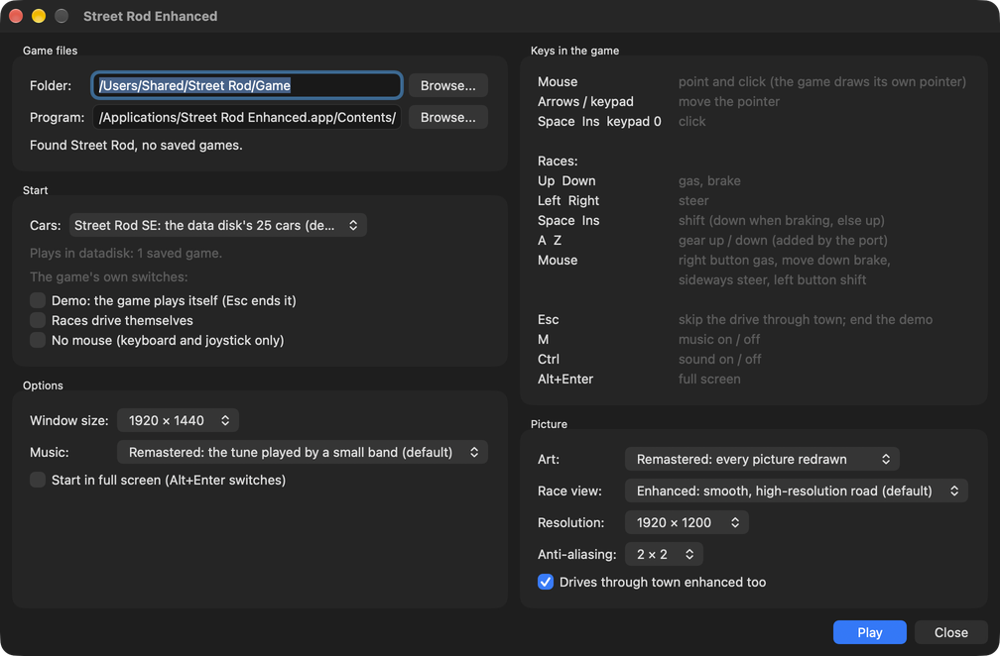

# Street Rod Enhanced

*Street Rod* (California Dreams, 1989) on today's computers: buy an old car in 1963 California, fix it up in
your garage and race it for pink slips. This is the original game, rebuilt to run natively on Windows and on
Apple Silicon Macs, with a smooth high-resolution road, separate music and sound volumes, the tune played by
a small band, and the option to show every picture redrawn at four times the resolution.

The sequel, *Street Rod 2: The Next Generation* (1991), comes with it: choose it under **Game** in the launcher.
It has the same window, full screen and volume comforts, its music played by the same small band, and the
smooth high-resolution road in town and in street drags; the remastered pictures, and the smooth road of its
other race kinds, are still to come for it.

The games themselves are free from their copyright owner and are not included here: the Mac app downloads them
for you, and on Windows you unzip them into a folder (see below).


## What you get

* **The original game.** The garage, the parts, the opponents, the races, the police and the endings are all
  the same, played from the original game files.
* **A smooth road.** Races and drives through town are drawn at your display's refresh rate, up to
  2560 × 1600, with anti-aliasing.
* **Remastered pictures**, a free download the launcher offers (26 MB). Every picture of the game redrawn as
  modern pixel art at four times the resolution, one click from the original. Painting your car, fades and the
  flashing signs still work on the new art.
* **Remastered music** (on by default). The game's own tune, note for note, played by a small band (bass, guitar
  or piano, drums) in stereo instead of the PC speaker.
* **Separate music and sound effects volumes.**
* **The Street Rod SE data disk's 25 cars**, one click away.
* **Street Rod 2: The Next Generation**, the sequel, with its songs played by the band too, or its AdLib or PC
  speaker music as it was, and the enhanced race view in town, on the drags, on Mulholland and in the mirror
  (the Aqueduct is still the original picture).
* **A launcher** for all of it, and a Mac app that downloads the games for you.


*The same car in the original (left) and remastered (right) pictures.*

## Download and play

### Windows

1. Download `Street-Rod-Enhanced-windows.zip` from the
   [Releases page](https://github.com/007hacky007/street-rod-remastered/releases) and unzip it somewhere you can
   write to, for example your Documents folder (not Program Files: saved games are kept next to the game).
2. Download the game from the official site, <https://www.streetrodonline.com/downloads/>:
   * **Street Rod** (`sr1pc.zip`): copy the files from its `SR1` folder into the `Game` folder of Street Rod
     Enhanced, so that `SR.EXE`, `LIB1`, `LIB2` and `HOT_DATA` are directly inside `Game`.
   * **Street Rod SE** (`srsepc.zip`, optional, for the 25 data disk cars): copy the files from its `SRSE`
     folder into a new folder `Game\datadisk`.
   * **Street Rod 2** (`sr2pc.zip`, optional): copy its files straight into the `Game2` folder, so that
     `SR.EXE`, `LIB1`, `LIB2`, `LIB3` and `SR2_DATA` are directly inside `Game2`.
3. Run `Street Rod Enhanced.exe`. It offers to download the remastered pictures (see below). Choose the game
   under **Game**, pick your options and press **Play**.

```text
Street Rod Enhanced\
├── Game\                        <- SR.EXE, LIB1, LIB2, HOT_DATA (and datadisk\ for Street Rod SE)
├── Game2\                       <- Street Rod 2: SR.EXE, LIB1, LIB2, LIB3, SR2_DATA ...
├── Street Rod Enhanced.exe      <- the launcher: start here
├── streetrod-enhanced.exe       <- Street Rod
├── streetrod2-enhanced.exe      <- Street Rod 2
└── the DLLs
```

### Mac

1. Download `Street-Rod-Enhanced.dmg` from the
   [Releases page](https://github.com/007hacky007/street-rod-remastered/releases) and open it.
2. Drag **Street Rod Enhanced** to **Applications**, then open it from there.
3. The app is free and open source but not signed by Apple, so macOS asks once before it opens it:
   * macOS 15 or newer: macOS says it cannot be opened, click **Done**. Open **System Settings** >
     **Privacy & Security**, scroll down and click **Open Anyway**.
   * macOS 14 or older: right-click the app and choose **Open**.
4. The launcher offers to download the game from streetrodonline.com, the official site (Street Rod and the
   Street Rod SE data disk, about 1 MB). Click **Download**, or **Choose Folder...** if you already have the
   files. Choosing **Street Rod 2** under **Game** offers its download (`sr2pc.zip`, about 1 MB) the same way.
5. The launcher then offers the remastered pictures (see below). Press **Play**.

Needs a Mac with Apple Silicon (M1 or later) and macOS 12 or newer. The game, your saved games, the
remastered pictures and the launcher's settings are kept in `~/Library/Application Support/Street Rod Enhanced`.

## The launcher



* **Game**: Street Rod or Street Rod 2. Each keeps its own folder, program and switches; the window size,
  the picture settings and the volumes are shared.
* **Game files**: where the game is. The line below says whether it was found and how many saved games there
  are; **Play** stays greyed out until the game is there.
* **Start**: **Cars** picks the original cars or the Street Rod SE data disk's 25 cars. The game's own
  switches: a self-playing demo, races that drive themselves, no mouse.
* **Options**: the window size, the **Music** (remastered or the original PC speaker), for Street Rod 2 the
  **Sound** (AdLib or PC speaker), and full screen.
* **Picture**: **Art** original or remastered (with **Download Pictures...** until they are downloaded),
  **Race view** enhanced or original, the resolution and the anti-aliasing of the road.
* **Game settings > Sounds** (in the menu): the music and sound effects volumes.

Every choice is remembered. More in [launcher/README.md](launcher/README.md).

### The remastered pictures

The redrawn pictures are a separate, free download (26 MB) from their own repository,
[street-rod-remastered-art](https://github.com/007hacky007/street-rod-remastered-art). On its first start the
launcher offers to download them; **Download Pictures...** next to **Art** does it later. When a newer set is
out, the launcher offers the update. Once they are there, **Art** is Remastered; **Art: Original** brings back
the game's own pictures. They are kept in the launcher's settings folder (`%APPDATA%\Street Rod Enhanced\Remaster`
on Windows). How the pictures were made: [REMASTER.md](REMASTER.md).

## Screenshots

All with the remastered pictures.

| | |
|---|---|
|  |  |
| At Gus's gas station | Cruising through town on the smooth road |
|  |  |
| The newspaper | The classifieds: buy your first car |

## Playing

* **Mouse**: point and click; the game draws its own pointer. Arrows or the keypad move the pointer too, and
  Space, Ins or keypad 0 click.
* **Races**: Up gas, Down brake, Left / Right steer, Space or Ins shift (down when braking, else up), A / Z
  gear up / down.
* **Esc** skips the drive through town and ends the demo. **M** music on / off, **Ctrl** sound on / off.
* **Full screen**: Alt+Enter. On a Mac also Ctrl+Cmd+F, Option+Return or the green window button.
* **On a Mac**: Cmd+Q quits. Mac keyboards have no Ins or keypad: Space clicks and shifts gear. Ctrl turns
  the sound on or off when you let go of it.
* One CPU core draws the road (about 8.5 ms a frame at the default). On a slow computer, lower the
  **Resolution** or the **Anti-aliasing** in the launcher.

## For developers

### Build

The remastered pictures are not part of this repository or of its builds: they live in
[street-rod-remastered-art](https://github.com/007hacky007/street-rod-remastered-art), and the launcher
downloads its latest release (`SRE_ART_BASE=<url>`, a developer aid, downloads from there instead).

Windows, in an MSYS2 UCRT64 shell with `mingw-w64-ucrt-x86_64-{gcc,cmake,ninja,sdl3,wxwidgets3.2-msw}` and
`zip`:

```bash
tools/windows/package.sh     # tests, then dist/Street-Rod-Enhanced-windows.zip
```

Or by hand:

```bash
cmake -S . -B build -G Ninja -DCMAKE_C_COMPILER=gcc -DCMAKE_CXX_COMPILER=g++ -DCMAKE_BUILD_TYPE=Release
cmake --build build
```

Mac (Apple Silicon, Xcode command line tools, CMake, Ninja and Python 3):

```bash
tools/macos/build-deps.sh                  # SDL3 and wxWidgets, static, into build-deps/prefix
tools/macos/package.sh --version 0.4.2     # tests, then dist/Street Rod Enhanced.app
tools/macos/make-dmg.sh --version 0.4.2    # dist/Street-Rod-Enhanced.dmg
```

* Needs CMake 3.24+, a C11 compiler and SDL 3; the launcher needs C++17 and wxWidgets 3.2.
* `-DSRE_LAUNCHER=OFF` builds the game only. On Windows the build copies the DLLs both programs need beside
  them.
* `-DSRE_TESTS=ON` builds the unit tests (`ctest --test-dir build`). With `-DSRE_TEST_GAME_DIR=<folder>` the
  remaster's picture tests run against the original game files too; with `-DSRE_TEST_GAME2_DIR=<folder>`
  (Street Rod 2's files) its checks, volumes and the 15 smoke paths (`ctest -L slow`, about 15 minutes) run.
* `tools/sr1-codecheck.sh BASE [HEAD]` builds Street Rod 1 at two commits and compares the compiled code of
  every file: a change meant only for Street Rod 2 must leave it the same.
* `tests/test_download` checks the download for real: `test_download <dir> ok` fetches the game into `<dir>`.

### Continuous integration

* **CI** (`.github/workflows/ci.yml`), on every push to master and every pull request: builds and tests the
  Mac app and the Windows zip, and runs the remaster tools' tests. Both packages are kept as artifacts of the
  run.
* **Release** (`.github/workflows/release.yml`), on a `v*` tag: builds the disk image and the Windows zip and
  attaches them to a draft release.

### Run the game directly

```bash
./build/streetrod-enhanced --game-dir Game
```

| Option | Meaning |
|---|---|
| `--game-dir DIR` | Game files folder (default `Game`) |
| `--scale N` | Window size, × 320×240 (default 3) |
| `--fullscreen` | Start in full screen |
| `--res-scale N` | Resolution, × 320×200 (default 4, 2 to 8) |
| `--aa N` | Anti-aliasing, N×N samples (default 2, 1 = off) |
| `--motion-delay P` | Smooth view delay, % of a game frame (default 100) |
| `--town on\|off` | Enhanced drives through town (default on) |
| `--music-volume P` | Music volume, % (default 100) |
| `--sfx-volume P` | Sound effects volume, % (default 100) |
| `--music original\|remastered` | The tune on the PC speaker or played by a small band (default original; the launcher defaults to remastered) |
| `--classic` | Original picture only |
| `--remaster-dir DIR` | Remastered pictures from the art pack in DIR (see [REMASTER.md](REMASTER.md)) |
| `--check` | Check that `SR.EXE` loads, then exit |
| `demo`, `auto`, `nomouse` | The original's switches: self-playing demo, races drive themselves, no mouse |

Street Rod 2 (work in progress) builds beside it as `streetrod2-enhanced`. Its game
files come from the official `sr2pc.zip` (streetrodonline.com); unpack them into a folder of their own:

```bash
./build/streetrod2-enhanced --game-dir Game2 v adlib
```

It takes `--game-dir`, `--scale`, `--fullscreen`, `--check`, `--classic`, `--res-scale`, `--aa`,
`--motion-delay`, `--town`, `--music-volume`, `--sfx-volume` and `--music original|remastered` as above (the
band plays its AdLib songs, or with `speaker` its PC speaker tune; the enhanced race view covers the town, the
drags, the Grudge drag strip, Mulholland and the mirror, the Aqueduct is still the original picture), and the
original's switches: `v` (VGA) and `adlib` or `speaker` skip its start-up menus, `demo` plays by
itself, `nomouse`. See [ENGINE2.md](ENGINE2.md).

### Layout

* `src/`: the game ([ENGINE.md](ENGINE.md)).
* `src2/`: Street Rod 2 ([ENGINE2.md](ENGINE2.md)).
* `common/`: the host both games run on (window, sound, input, files); `third_party/nuked-opl3/`: the AdLib
  chip of Street Rod 2.
* `src/enhanced/`: the enhanced road view ([ENHANCED.md](ENHANCED.md)).
* `src/remaster/`, `tools/remaster/`: the remastered pictures and the tools that build the art pack
  ([REMASTER.md](REMASTER.md)).
* `launcher/`: the launcher ([launcher/README.md](launcher/README.md)).
* `tools/macos/`, `tools/windows/`: packaging.

## License

MIT ([LICENSE](LICENSE)). *Street Rod* is © California Dreams / Logical Design Works and *Street Rod 2* ©
California Dreams; their files are not included. Nuked-OPL3 (`third_party/nuked-opl3`) is under the GNU LGPL
2.1 or later.
